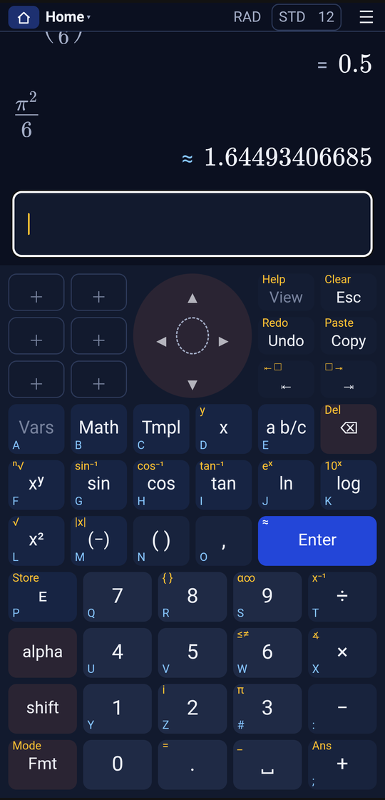
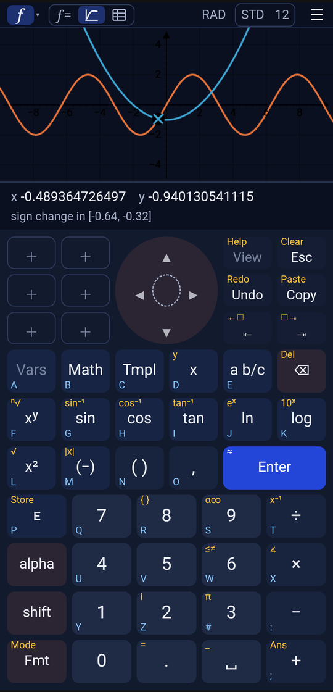
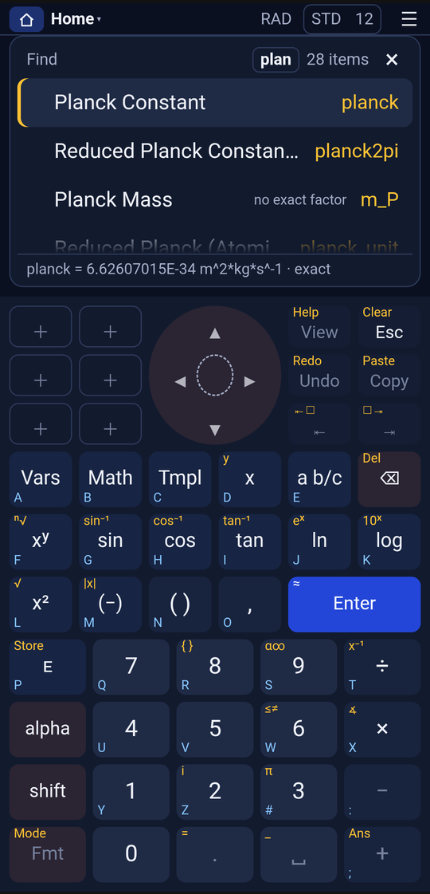

<p align="center">
  <picture>
    <source media="(prefers-color-scheme: dark)" srcset="logo/wordmark/pascaline_wordmark_light.svg">
    
  </picture>
</p>

<p align="center">
  A graphing calculator for engineers.<br>
  The key layout of the HP Prime, our own look, and answers you can trust.<br>
  Free, offline and open source.
</p>

<p align="center">
  <b><a href="https://pascaline-calc.org/">▶ Try it in your browser</a></b> · Android: coming soon
</p>

<!-- Screenshots: the same files F-Droid shows (backlog R3); taken on the Fairphone 6, 2026-10-29. Retake when the look changes. -->
<p align="center">
  
  
  
</p>

> Pascaline is still young: there is no release yet, and things move fast.
> On iPhone or iPad, add it to your Home Screen, or Safari may delete its data after about a week without a visit.

## What it does

- **Type maths the way it looks.** Fractions, roots and powers appear as you write them, on a keyboard built for it.
- **Exact when it can be, honest when it can't.** `=` means the answer is exact. `≈` means it's rounded, and every digit shown is correct. `⚠` means we couldn't check it. Up to 30 digits.
- **Algebra too.** Simplify, factor, differentiate and integrate in the CAS view.
- **Graphs.** Plot functions, then find roots, intersections, extrema, slope and area right on the graph.
- **Solve.** Equations, systems and polynomials. Every root is put back into the equation to check it.
- **Find.** One search box for every function, constant and unit.
- **Nothing gets lost.** Reuse a result and you get its full value, not just the digits on screen. Copy or share it the same way.
- **Works offline.** Everything runs on your phone or in your browser. No account, no ads, no tracking.

If you know the HP Prime, the keys will feel familiar: the functions sit where you expect them. The design is our own.

## Coming next

- **Units:** convert, and check that units match as you calculate (`3 m + 20 cm`).
- **Physical constants** and **uncertainty** that travels with the number (`9.81 ± 0.02`).
- **Matrices, vectors and number bases.**
- **Engineering helpers:** parallel resistance, E-series, dB and interpolation.
- **Later:** statistics, a spreadsheet, more plot types, 3D, iOS and desktop.

Want the details? [The task list](docs/backlog.md).

## Build it yourself

```bash
engine/giac/build-wasm.sh          # the maths engine → WebAssembly (needs emsdk, about 5 min)
cd app && npm ci && npm run dev    # open http://localhost:5173
./build.sh                         # the Android app → dist/pascaline.apk
```

Every source download is pinned and checked, release builds are reproducible, and the app has no Google services, so it's ready for F-Droid. How it works inside: [docs/04-architecture.md](docs/04-architecture.md).

## Built on

Pascaline stands on the shoulders of [Giac](https://xcas.univ-grenoble-alpes.fr/), the computer algebra system by Bernard Parisse and Renée De Graeve. Also: [GSL](https://www.gnu.org/software/gsl/), [GMP](https://gmplib.org/), [MPFR](https://www.mpfr.org/), [libqalculate](https://qalculate.github.io/), [MathLive](https://mathlive.io/), [JSXGraph](https://jsxgraph.org/), [Svelte](https://svelte.dev/) and [Capacitor](https://capacitorjs.com/). Versions and licences: [THIRD_PARTY.md](THIRD_PARTY.md).

## Contributing

Bug reports and ideas are very welcome. Open an issue. For code, see [CONTRIBUTING.md](CONTRIBUTING.md). The project is clean-room (no HP code, firmware or artwork), and every commit needs a DCO sign-off (`git commit -s`).

## License

Copyright © 2026 Pascaline contributors. [GPL-3.0-or-later](LICENSE); the licence texts of the parts it ships are in [LICENSES/](LICENSES/) and their notices in [THIRD_PARTY.md](THIRD_PARTY.md). What the app stores and sends (nothing leaves the device): [PRIVACY.md](PRIVACY.md).

---

<sub>Not affiliated with HP Inc. or Moravia Consulting. HP and HP Prime are trademarks of HP Inc., named only to describe the key layout. Pascaline is named after Blaise Pascal's 1642 calculating machine.</sub>
